# Correlation Heatmap

[](https://github.com/Dhirajdas18/correlation-heatmap/actions/workflows/ci.yml)
[](https://dhirajdas18.github.io/correlation-heatmap/)

Which NIFTY 50 stocks move together, how much, and how that changes: clustering, measurement choices, noise
against signal, correlation through time, market networks, diversification, and links to the US market,
gold and the rupee, measured on NSE data.

**Live heatmap: [dhirajdas18.github.io/correlation-heatmap](https://dhirajdas18.github.io/correlation-heatmap/)**.
Pick a window, daily or weekly returns, Pearson or rank correlation, keep or remove the market, order by
cluster or by NSE sector, and click any square to see that
pair's correlation through time; below it, the minimum spanning tree for the same settings. It runs in your browser on five years of daily returns, rebuilt weekly.

## Features

- [x] Heatmap ordered by hierarchical clustering, with and without the market; clusters against NSE sectors
- [x] Measurement: Pearson against rank correlation; daily to quarterly returns; overnight against intraday; rank and weekly options in the heatmap
- [x] Noise against signal: random matrix theory, the market factor's share over time, cleaning the matrix; factor count in the heatmap
- [x] Correlation through time: rolling, EWMA, DCC and their forecasts; falling together against rising together; EWMA line in the heatmap
- [x] Networks: minimum spanning tree, hubs, yearly trees and link survival; live tree on the dashboard
- [x] Diversification: effective number of bets; hierarchical risk parity walk-forward after costs; bets count in the heatmap
- [x] Across assets and time zones: US market, gold, the rupee; the US session in NIFTY's opening gap; live cross-asset chart

## Findings

### 1. Stocks moved with the market first: average correlation 0.26, and clustering raw correlations found one 29-stock block; with the market removed, 12 clusters matched NSE sectors twice as well

<a href="docs/img/heat_matrix.png"><picture><source media="(prefers-reduced-motion: reduce)" srcset="docs/img/heat_matrix.png">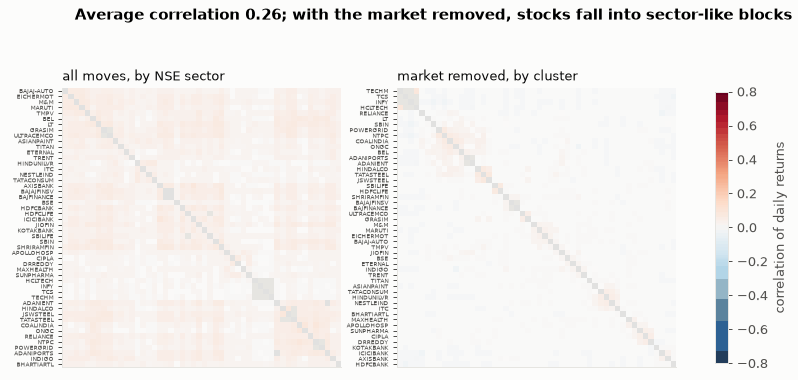</picture></a>

Daily returns of today's NIFTY 50 stocks, 23 November 2023 to 23 November 2026 (740 days on which all 50
traded). Distance between two stocks is √(2(1 − correlation)); average-linkage clustering joins the closest
groups step by step, and its leaf order puts similar stocks side by side. "Market removed" takes out each
stock's beta × NIFTY's daily return (beta from the same days) before correlating what is left.

- **The market dominates:** the average pair correlated 0.26 (0.41 within the same NSE sector). The tightest
  pairs were ADANIENT–ADANIPORTS 0.81, BAJFINANCE–BAJAJFINSV 0.77, INFY–TCS 0.74 and JSWSTEEL–TATASTEEL 0.74;
  the loosest HINDUNILVR–ONGC 0.03.
- **Raw correlations cluster by how much a stock follows the market:** cut into 12 clusters, one held 29 of
  the 50 stocks, and the grouping matched NSE's sector labels with an adjusted Rand index of 0.16 (1 = the
  same grouping, 0 = unrelated).
- **With the market removed, sectors appear (adjusted Rand 0.35):** IT (TCS, INFY, HCLTECH, TECHM); private
  banks (HDFCBANK, ICICIBANK, AXISBANK, KOTAKBANK); Bajaj Finance, Bajaj Finserv and Shriram Finance;
  the two insurers; autos; cement; consumer staples with Asian Paints and Titan; pharma with the two
  hospital chains; and two mixed groups: state-owned companies (SBIN, NTPC, POWERGRID, ONGC, COALINDIA, BEL)
  with metals, the two Adani stocks and LT, and recent or high-growth listings (BSE, ETERNAL, INDIGO,
  JIOFIN, TRENT, TMPV).
- **Fairly stable:** clustering each half of the window separately gave groupings that agreed at 0.58.

<table><tr>
<td><a href="docs/img/heat_tree.png"><picture><source media="(prefers-reduced-motion: reduce)" srcset="docs/img/heat_tree.png"></picture></a></td>
<td><a href="docs/img/heat_misfits.png"><picture><source media="(prefers-reduced-motion: reduce)" srcset="docs/img/heat_misfits.png"></picture></a></td>
</tr></table>

- **Misfits (right):** with the market removed, 11 of the 47 stocks in sectors with more than one member
  moved more with another sector. SBIN correlated 0.25 with the capital-goods stock BEL and 0.02 on
  average with the other financials; ADANIENT 0.40 with ADANIPORTS (Services) against 0.07 with metals.
  NSE's 12-stock "Financial Services" spread over four clusters (private banks, Bajaj and Shriram,
  insurers, and BSE and JIOFIN with the recent listings); five of its stocks averaged 0.02 to 0.10 with the
  rest of it. ONGC and KOTAKBANK are near-ties (within 0.01).

### 2. Ten of 3,181 days lifted the average correlation from 0.241 to 0.275, and overnight gaps correlated twice as much as daytime moves (0.46 against 0.22)

<a href="docs/img/meas_overnight.png"><picture><source media="(prefers-reduced-motion: reduce)" srcset="docs/img/meas_overnight.png"></picture></a>

The 43 of today's NIFTY 50 stocks with prices on every day from January 2014 to November 2026 (3,181 days).
Overnight is the previous close to the open, intraday the open to the close; the two multiply back to the
day's return. Yahoo's opening prices are wrong on some demerger days (ADANIENT showed a +220% gap on
3 June 2015), so 88 stock-days whose overnight and intraday moves were both over 10% in opposite directions
were dropped.

- **Overnight moves were shared, daytime moves less so:** the average pair correlated 0.46 overnight and
  0.22 intraday, and overnight was higher in every year from 2014 to 2026 (0.71 against 0.33 in 2020).
  Overnight gaps carried 21% of the average stock's daily variance.

<table><tr>
<td><a href="docs/img/meas_methods.png"><picture><source media="(prefers-reduced-motion: reduce)" srcset="docs/img/meas_methods.png"></picture></a></td>
<td><a href="docs/img/meas_horizon.png"><picture><source media="(prefers-reduced-motion: reduce)" srcset="docs/img/meas_horizon.png">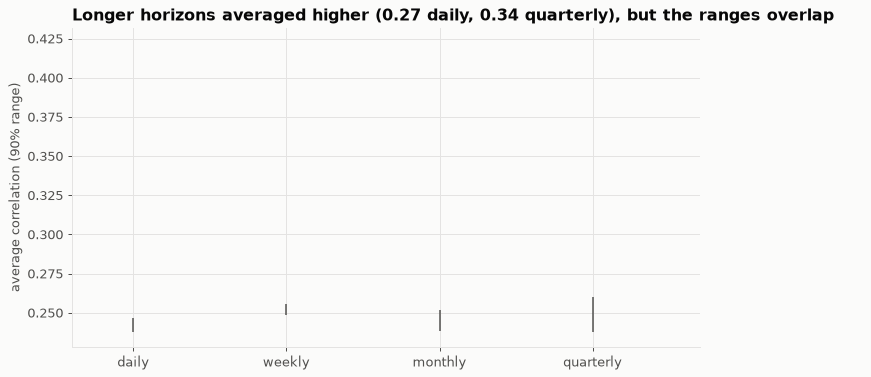</picture></a></td>
</tr></table>

- **A few days carry a lot of the correlation (left):** leaving out the 10 days with the biggest average move
  (seven of them in March–May 2020, plus 24 August 2015, 20 September 2019 and 4 June 2024) lowered the
  average Pearson correlation from 0.275 to 0.241. Rank correlations count each day by its order only:
  Spearman 0.256 and Kendall 0.176, which on Pearson's scale (2·sin(π·ρs/6) and sin(π·τ/2), exact for
  normal data) are 0.267 and 0.272.
- **Horizon (right):** daily 0.275, weekly 0.279, monthly 0.295, quarterly 0.337. The 90% ranges, from
  resampling whole months, overlap (daily 0.238–0.312, quarterly 0.242–0.420), so 13 years can't separate
  them.

### 3. Only 4 of 43 eigenvalues stood above the noise band; the market factor's share peaked after the 2020 crash, not before it, and cleaning the matrix changed nothing out of sample

<a href="docs/img/rmt_spectrum.png"><picture><source media="(prefers-reduced-motion: reduce)" srcset="docs/img/rmt_spectrum.png"></picture></a>

A 43×43 correlation matrix (the stocks with prices every day from January 2014 to November 2026, 3,181 days)
has 43 eigenvalues that add up to 43; each measures how much movement one independent pattern explains.
Random matrix theory gives the range they would fill if the stocks were unrelated: the Marchenko-Pastur
band, (1 ± √(N/T))², here 0.78 to 1.25. Eigenvalues above it are real common movement.

- **Four real factors:** 12.95 (the market, 30% of all movement), 2.37, 1.90 and 1.58; together the other
  three explained 14%. The fifth, 1.24, sat just inside the band. Shuffling each stock's days in time (same
  returns, no co-movement) gave eigenvalues from 0.80 to 1.23, matching the band. 29 of the 43 fell below
  the band's lower edge; since the eigenvalues add up to 43 and the four factors take 18.8, the other 39
  average 0.62.

<table><tr>
<td><a href="docs/img/rmt_factors.png"><picture><source media="(prefers-reduced-motion: reduce)" srcset="docs/img/rmt_factors.png">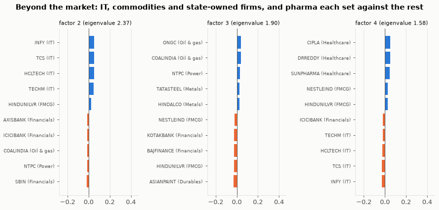</picture></a></td>
<td><a href="docs/img/rmt_share.png"><picture><source media="(prefers-reduced-motion: reduce)" srcset="docs/img/rmt_share.png">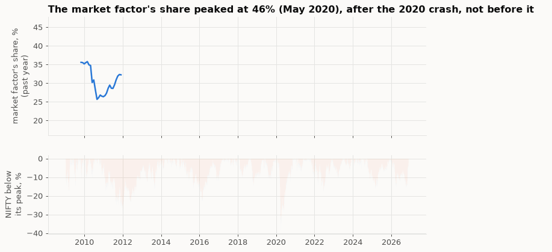</picture></a></td>
</tr></table>

- **What the other three are (left):** factor 2 set IT (INFY, TCS, HCLTECH, TECHM) against banks and
  state-owned firms; factor 3 commodities and state-owned firms (ONGC, COALINDIA, NTPC, Tata Steel, Hindalco)
  against consumer names and lenders; factor 4 pharma with HUL and Nestlé against IT and ICICI Bank.
- **The market factor's share over time (right):** measured on each past year, monthly from 2009, it
  averaged 29%, fell to 18% in January 2018 and peaked at 46% in May 2020, after the March 2020 crash.
  Across 202 months its level did not predict the next month's NIFTY return (rank correlation 0.06,
  p = 0.39), nor did its 3-month change (0.02, p = 0.78). It went with higher volatility the next month
  (0.25), but this month's volatility did that better (0.61).
- **Cleaning didn't help:** every 6 months from 2014, a minimum-variance portfolio (shorting allowed) was
  built from the past 2 years' covariance, raw or with the noise eigenvalues replaced by their average
  ("clipping"), and held for 6 months. Over 25 periods both predicted 0.69% daily volatility and delivered
  0.79%; clipping changed realised volatility by 0.001 points.

### 4. Stocks moved together 0.24 on joint falls and 0.11 on joint rises; DCC forecast portfolio risk best, significantly so for IT against banks

<a href="docs/img/time_exceed.png"><picture><source media="(prefers-reduced-motion: reduce)" srcset="docs/img/time_exceed.png">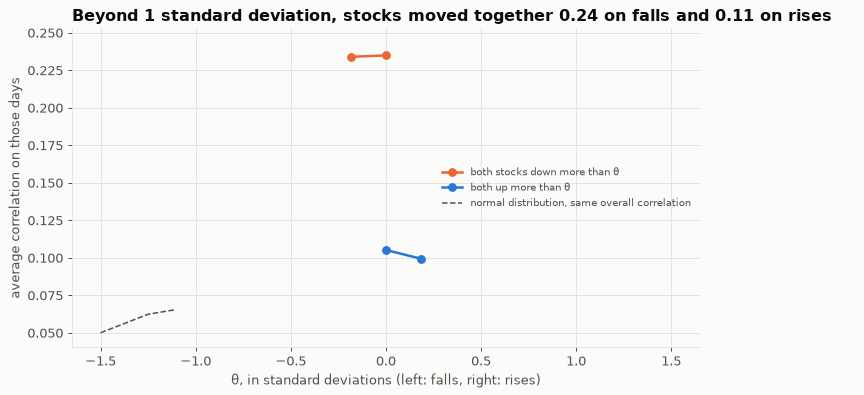</picture></a>

The 43 stocks with prices every day, January 2014 to November 2026. Each day's return is divided by the
stock's previous-day EWMA volatility (λ 0.94), so the measures below track correlation rather than
volatility. Exceedance correlation (Longin and Solnik) is the correlation on the days both stocks fell more
than θ standard deviations, or both rose more than θ; for normally distributed returns the two sides are
the same and both shrink as θ grows.

- **Falls were shared more than rises:** on days both stocks fell, the average pair correlated 0.235;
  on days both rose, 0.105, close to the 0.103 a normal distribution would give. Beyond 1 standard
  deviation it was 0.237 on falls, 0.106 on rises and 0.068 for the normal distribution; the gap held at
  every threshold up to 1.5.

<table><tr>
<td><a href="docs/img/time_avg.png"><picture><source media="(prefers-reduced-motion: reduce)" srcset="docs/img/time_avg.png">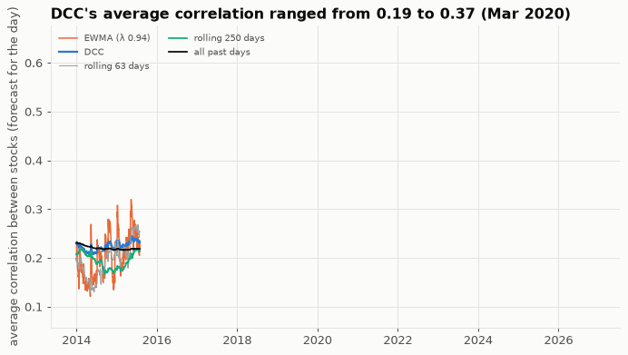</picture></a></td>
<td><a href="docs/img/time_forecast.png"><picture><source media="(prefers-reduced-motion: reduce)" srcset="docs/img/time_forecast.png">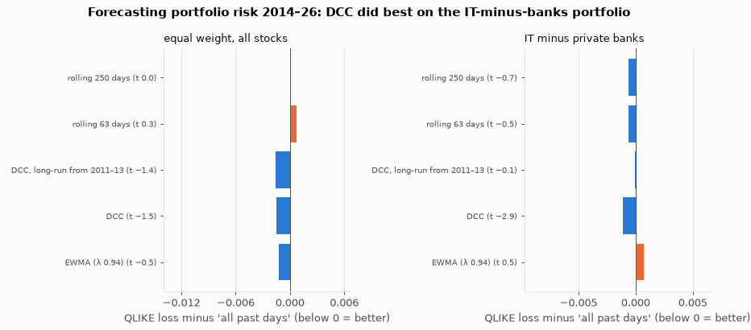</picture></a></td>
</tr></table>

Each tracker forecasts tomorrow's correlation from days before it: EWMA (λ 0.94), DCC(1,1) (Engle 2002;
its two settings, a = 0.007 and b = 0.978, estimated on 2010–2013 only), rolling 63 and 250 days, and the
average of all past days.

- **How much correlation moved (left):** DCC's average ranged from 0.19 to 0.37 (24 March 2020); EWMA's
  from 0.09 to 0.65 and the 63-day window's from 0.09 to 0.60, both much jumpier.
- **Which forecast was right (right):** each method's correlation, combined with the same EWMA volatilities,
  forecast the daily variance of two portfolios, scored by QLIKE (log σ̂² + r²/σ̂², lowest for the true
  variance) against the all-past-days forecast, with Newey-West t-statistics. DCC had the lowest loss on
  both: −0.016 (t −1.6, not significant) for an equal-weight portfolio of the 43, and −0.015 (t −3.2) for
  long IT (TCS, INFY, HCLTECH, TECHM) against short private banks (HDFCBANK, ICICIBANK, AXISBANK,
  KOTAKBANK). EWMA and the rolling windows were within t ±0.8 of the all-past forecast.

### 5. The market's skeleton: 49 links averaging 0.50 correlation; the tree was tightest in 2020, and only 24–48% of its links survived from one year to the next

<a href="docs/img/net_tree.png"><picture><source media="(prefers-reduced-motion: reduce)" srcset="docs/img/net_tree.png">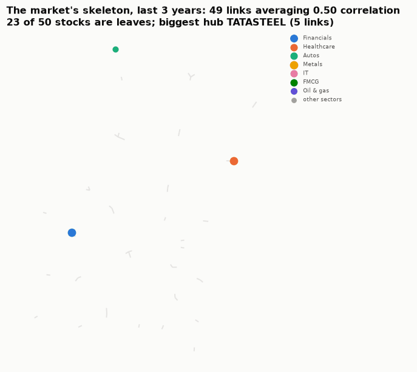</picture></a>

The minimum spanning tree keeps the N − 1 links, with distance √(2(1 − correlation)), that connect all N
stocks at the smallest total distance: each stock joins the tree through the stock it moves most with,
and there are no loops (Mantegna 1999). A stock with many links is a hub.

- **Last 3 years (above):** the 49 links averaged 0.50 correlation, against 0.27 for all pairs. 23 of the
  50 stocks were leaves (one link). The biggest hub was Tata Steel (5 links), then UltraTech Cement,
  Shriram Finance, NTPC and L&T (4 each). The private banks, Bajaj Finance and Finserv, Shriram and the two
  insurers hung off one branch (SBI, Jio Financial and BSE sat elsewhere); IT, pharma with the hospitals,
  four of the five autos, and FMCG each formed their own.

<table><tr>
<td><a href="docs/img/net_years.png"><picture><source media="(prefers-reduced-motion: reduce)" srcset="docs/img/net_years.png">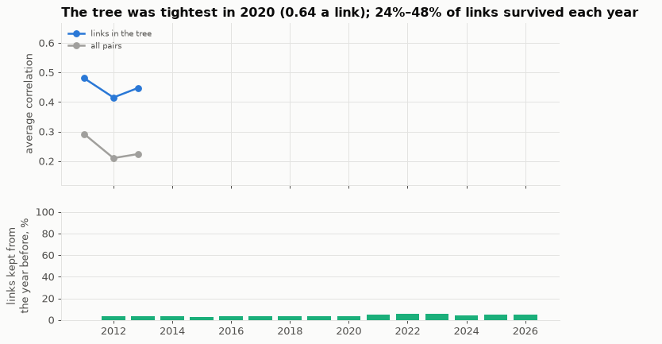</picture></a></td>
<td><a href="docs/img/net_hubs.png"><picture><source media="(prefers-reduced-motion: reduce)" srcset="docs/img/net_hubs.png">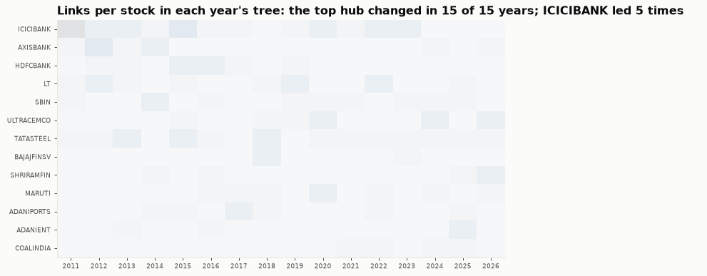</picture></a></td>
</tr></table>

One tree per calendar year, 2011 to 2026 (2026 to November), for the 43 stocks with prices every day.

- **Tightness (left):** the average tree link ranged from 0.36 (2017) to 0.64 (2020), moving with the
  all-pairs average (0.15 to 0.43).
- **Turnover (left):** 24% (2015) to 48% (2022) of a year's links were also in the next year's tree.
- **Hubs (right):** the stock with the most links was different from the year before in all 15 years
  (ties broken by name order, in 2021 and 2026). ICICI Bank led 5 times, with 13 links in 2011; L&T twice.

### 6. 43 stocks held equally were worth 2.2 to 5.8 independent bets; hierarchical risk parity landed between inverse volatility and minimum variance and paid the most in costs

<a href="docs/img/div_bets.png"><picture><source media="(prefers-reduced-motion: reduce)" srcset="docs/img/div_bets.png">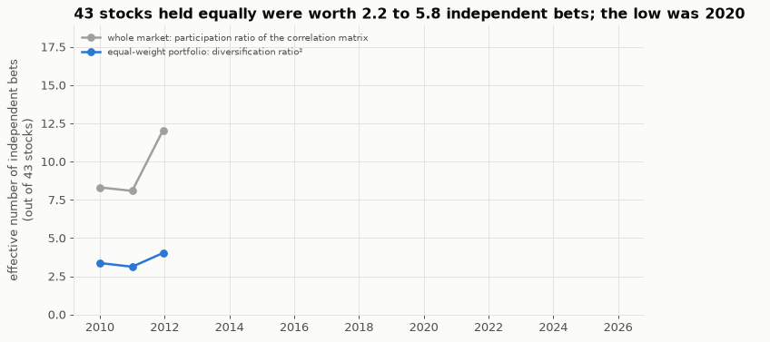</picture></a>

How many independent bets is a portfolio? For a portfolio, the square of the diversification ratio
(Σ wᵢσᵢ / σ_p, Choueifaty) counts them: N for N unrelated, equally risky stocks held equally. For the
whole market, the participation ratio of the correlation matrix's eigenvalues, (Σλ)² / Σλ², does the same.
The 43 stocks with prices every day, one calendar year at a time, 2010–2026.

- **Few bets:** held equally, the 43 stocks were worth 2.2 (2020) to 5.8 (2017) independent bets. The
  correlation matrix itself ranged from 4.6 (2020) to 18.1 (2017).

<table><tr>
<td><a href="docs/img/div_walk.png"><picture><source media="(prefers-reduced-motion: reduce)" srcset="docs/img/div_walk.png">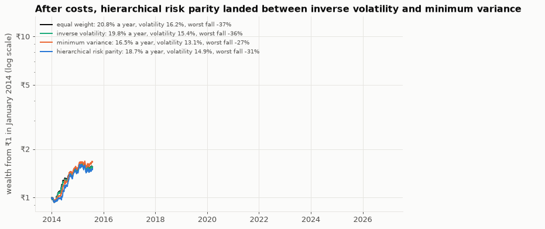</picture></a></td>
<td><a href="docs/img/div_costs.png"><picture><source media="(prefers-reduced-motion: reduce)" srcset="docs/img/div_costs.png">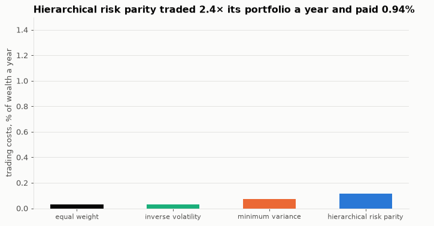</picture></a></td>
</tr></table>

Hierarchical risk parity (López de Prado 2016) builds a tree of the stocks from their correlations and,
from the top down, splits each branch's money between its two sub-branches in inverse proportion to their
variance, with no matrix inversion. Here the split follows the tree's own branches (the original bisects
the ordered list, which can cut a cluster in two). Walk-forward from January 2014: each month end, weights
from the past 250 days only, long only, ₹10 lakh, after Zerodha delivery costs (STT 0.1% both sides, stamp
duty, exchange charges, ₹15.93 DP charge per stock sold, 0.05% slippage).

| 2014–2026 | Growth a year | Volatility | Worst fall | Growth ÷ volatility | Turnover a year | Costs a year | Independent bets |
|---|---|---|---|---|---|---|---|
| equal weight | 20.8% | 16.2% | −37% | 1.28 | 0.4× | 0.26% | 3.7 |
| inverse volatility | 19.8% | 15.4% | −36% | 1.29 | 0.4× | 0.27% | 3.9 |
| minimum variance | 16.5% | 13.1% | −27% | 1.26 | 1.6× | 0.59% | 4.8 |
| hierarchical risk parity | 18.7% | 14.9% | −31% | 1.26 | 2.4× | 0.94% | 4.2 |

- **In between:** hierarchical risk parity's volatility and worst fall sat between inverse volatility and
  minimum variance; growth per unit of volatility was within 0.03 across all four.
- **The cost of the tree:** it turned over 2.4 times its portfolio a year, paying 0.94% a year, and held
  20% in its largest stock on average.
- These are today's NIFTY members, so every method's growth is inflated by survivorship; ef/04 runs
  weighting methods on a point-in-time universe.

### 7. The US session showed up in NIFTY's opening gap (correlation 0.52), not after the open; weekly, NIFTY moved with the US (0.48) and against the dollar (−0.40), and was unrelated to gold

<a href="docs/img/cross_leadlag.png"><picture><source media="(prefers-reduced-motion: reduce)" srcset="docs/img/cross_leadlag.png">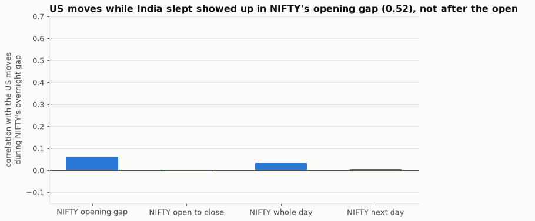</picture></a>

NSE closes at 15:30 IST; the US cash session runs from about 19:00 to 01:30 IST, so every US session dated
on or after NSE's previous trading day falls inside NIFTY's overnight gap. For each NSE day since January
2011 (3,896 days; Yahoo's NIFTY opens before 2011 sit almost on the previous close), the S&P 500 total
return over those sessions is set against NIFTY's opening gap, its open-to-close move, its whole day and the
next day.

| NIFTY move | Correlation with the US move overnight | Slope | t |
|---|---|---|---|
| opening gap | **0.52** | 0.30 | 38.0 |
| open to close | −0.04 | −0.03 | −2.7 |
| whole day | 0.28 | 0.27 | 18.1 |
| next day | 0.04 | 0.04 | 2.3 |

- **Priced at the open:** each 1% the US moved overnight, NIFTY opened 0.30% the same way. After the
  open, NIFTY gave back a little (slope −0.03), with the same sign in 2011–2018 (t −1.8) and 2019–2026
  (t −2.0). The next-day link held in the first half (t 2.8) but not the second (t 0.8).

<table><tr>
<td><a href="docs/img/cross_gap.png"><picture><source media="(prefers-reduced-motion: reduce)" srcset="docs/img/cross_gap.png">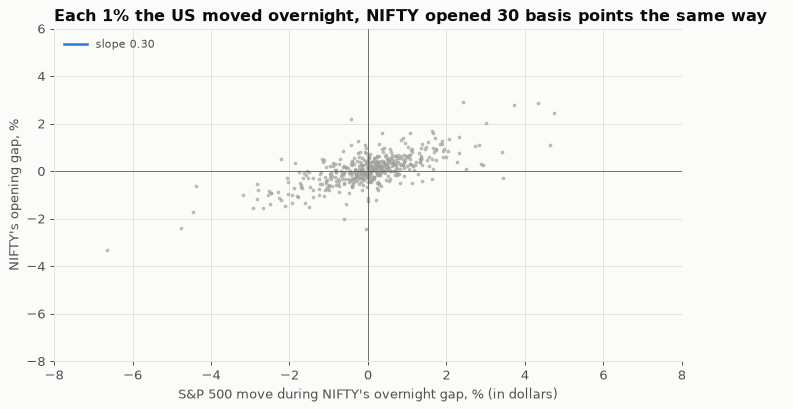</picture></a></td>
<td><a href="docs/img/cross_rolling.png"><picture><source media="(prefers-reduced-motion: reduce)" srcset="docs/img/cross_rolling.png">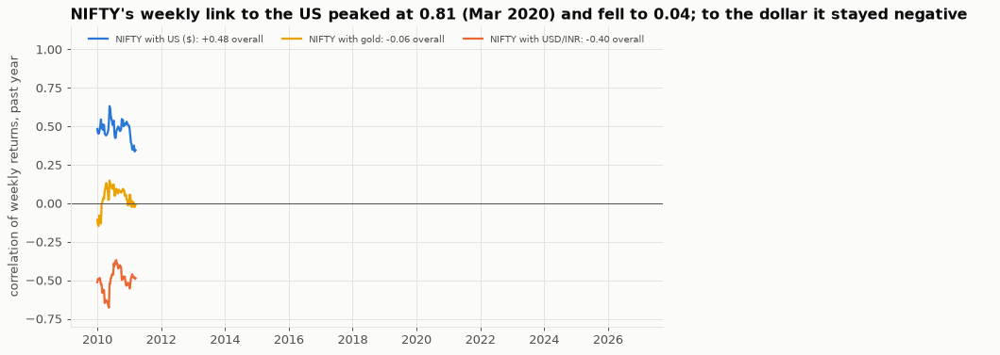</picture></a></td>
</tr></table>

Weekly (Friday-to-Friday, each market at its own last close), January 2009 to November 2026, 934 weeks:
NIFTY ETF against the S&P 500 total return (in dollars and in rupees), the gold ETF and USD/INR.

- **Overall:** NIFTY correlated 0.48 with the US market in dollars (0.33 in rupees), −0.40 with the dollar's
  price in rupees and −0.06 with gold.
- **Over time (right):** the past year's link to the US peaked at 0.81 (March 2020) and was 0.38 at the
  end of October 2026; the week to 6 November (NIFTY +8.1%, US −2.7%) took it to 0.17, and two more
  opposite weeks to 0.00. Against the dollar it stayed between −0.68 and −0.11; against gold it swung
  between −0.48 and 0.33.

## Quick start

```bash
uv sync
uv run python scripts/fetch_data.py         # Yahoo Finance -> data/prices.parquet, data/global.parquet
uv run ch report heatmap                    # also: measure, rmt, time, network, diversify, cross
uv run python scripts/build_site.py         # dashboard -> site/index.html
uv run pytest
```

## Design

- `src/ch/cluster.py`: correlation over common days, distance √(2(1 − ρ)), average-linkage clustering with
  optimal leaf order, adjusted Rand index, sector fit, and market removal.
- `src/ch/measure.py`: rank correlations and their conversion to Pearson's scale, returns over longer
  periods, overnight and intraday returns, and a month-block bootstrap of the average correlation.
- `src/ch/rmt.py`: eigenvalues, the Marchenko-Pastur band and density, shuffling, eigenvalue clipping and
  the market factor's share.
- `src/ch/timevar.py`: EWMA standardisation, EWMA and DCC correlation forecasts (DCC fitted by composite
  likelihood over pairs), exceedance correlation and the QLIKE loss.
- `src/ch/network.py`: minimum spanning tree, degrees, average link correlation, link overlap between
  trees and a radial layout.
- `src/ch/diversify.py`: participation ratio, diversification ratio, inverse volatility, long-only
  minimum variance, hierarchical risk parity along the tree, Zerodha delivery costs and a monthly
  walk-forward.
- `src/ch/crossasset.py`: the US sessions inside NIFTY's overnight gap, weekly returns on each market's
  own calendar, regression and rolling correlation.
- `src/ch/heat.js`, `heatmap.html`: the same correlation (values or ranks, daily or weekly), market
  removal, clustering and eigenvalues (Jacobi) in the browser; a
  test runs them through Node against Python. Five years of returns are embedded as integers (0.001% units).
- `src/ch/data.py`: Yahoo prices for today's NIFTY 50, the index and two ETFs since 2007, with known errors
  repaired from `docs/data/yahoo_fixes.csv`; the S&P 500 total-return index and USD/INR in a separate
  table. Every series was scanned for one-day spike-and-reverse prints against the index; the remaining
  ones sit inside each day's traded range.
- `src/ch/reports.py`: README findings, reproducible with `ch report <topic>`.
- `src/ch/site.py`, `page.html`: the dashboard, one static page; no server.

MIT licence.
