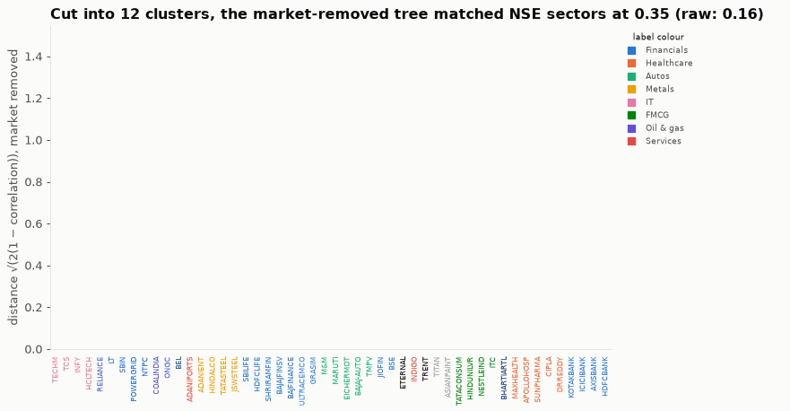

# Correlation Heatmap

[](https://github.com/Dhirajdas18/correlation-heatmap/actions/workflows/ci.yml)
[](https://dhirajdas18.github.io/correlation-heatmap/)

Which NIFTY 50 stocks move together, how much, and how that changes: clustering, measurement choices, noise
against signal, correlation through time, market networks, diversification, and links to the US market,
gold and the rupee, measured on NSE data.

**Live heatmap: [dhirajdas18.github.io/correlation-heatmap](https://dhirajdas18.github.io/correlation-heatmap/)**.
Pick a window, keep or remove the market, order by cluster or by NSE sector, and click any square to see that
pair's correlation through time. It runs in your browser on five years of daily returns, rebuilt weekly.

## Features

- [x] Heatmap ordered by hierarchical clustering, with and without the market; clusters against NSE sectors
- [ ] Measurement: Pearson against rank correlation; daily, weekly and monthly returns; overnight against intraday
- [ ] Noise against signal: random matrix theory, the market factor's share over time
- [ ] Correlation through time: rolling, EWMA, DCC; falling together against rising together
- [ ] Networks: minimum spanning tree, hubs, 2020
- [ ] Diversification: effective number of bets; hierarchical risk parity walk-forward
- [ ] Across assets and time zones: US market, gold, the rupee; lead and lag

## Findings

### 1. Stocks moved with the market first: average correlation 0.26, and clustering raw correlations found one 29-stock block; with the market removed, 12 clusters matched NSE sectors twice as well

<a href="docs/img/heat_matrix.png"><picture><source media="(prefers-reduced-motion: reduce)" srcset="docs/img/heat_matrix.png"></picture></a>

Daily returns of today's NIFTY 50 stocks, 23 November 2023 to 23 November 2026 (740 days on which all 50
traded). Distance between two stocks is √(2(1 − correlation)); average-linkage clustering joins the closest
groups step by step, and its leaf order puts similar stocks side by side. "Market removed" takes out each
stock's beta × NIFTY's daily return (beta from the same days) before correlating what is left.

- **The market dominates:** the average pair correlated 0.26 (0.41 within the same NSE sector). The tightest
  pairs were ADANIENT–ADANIPORTS 0.81, BAJFINANCE–BAJAJFINSV 0.77, INFY–TCS 0.74 and JSWSTEEL–TATASTEEL 0.74;
  the loosest HINDUNILVR–ONGC 0.03.
- **Raw correlations cluster by how much a stock follows the market:** cut into 12 clusters, one held 29 of
  the 50 stocks, and the grouping matched NSE's sector labels with an adjusted Rand index of 0.16 (1 = the
  same grouping, 0 = unrelated).
- **With the market removed, sectors appear (adjusted Rand 0.35):** IT (TCS, INFY, HCLTECH, TECHM); private
  banks (HDFCBANK, ICICIBANK, AXISBANK, KOTAKBANK); Bajaj Finance, Bajaj Finserv and Shriram Finance;
  the two insurers; autos; cement; consumer staples with Asian Paints and Titan; pharma with the two
  hospital chains; and two mixed groups: state-owned companies (SBIN, NTPC, POWERGRID, ONGC, COALINDIA, BEL)
  with metals, the two Adani stocks and LT, and recent or high-growth listings (BSE, ETERNAL, INDIGO,
  JIOFIN, TRENT, TMPV).
- **Fairly stable:** clustering each half of the window separately gave groupings that agreed at 0.58.

<table><tr>
<td><a href="docs/img/heat_tree.png"><picture><source media="(prefers-reduced-motion: reduce)" srcset="docs/img/heat_tree.png"></picture></a></td>
<td><a href="docs/img/heat_misfits.png"><picture><source media="(prefers-reduced-motion: reduce)" srcset="docs/img/heat_misfits.png"></picture></a></td>
</tr></table>

- **Misfits (right):** with the market removed, 11 of the 47 stocks in sectors with more than one member
  moved more with another sector. SBIN correlated 0.25 with the capital-goods stock BEL and 0.02 on
  average with the other financials; ADANIENT 0.40 with ADANIPORTS (Services) against 0.07 with metals.
  NSE's 12-stock "Financial Services" spread over four clusters (private banks, Bajaj and Shriram,
  insurers, and BSE and JIOFIN with the recent listings); five of its stocks averaged 0.02 to 0.10 with the
  rest of it. ONGC and KOTAKBANK are near-ties (within 0.01).

## Quick start

```bash
uv sync
uv run python scripts/fetch_data.py         # Yahoo Finance -> data/prices.parquet, data/global.parquet
uv run ch report heatmap                    # charts -> out/
uv run python scripts/build_site.py         # dashboard -> site/index.html
uv run pytest
```

## Design

- `src/ch/cluster.py`: correlation over common days, distance √(2(1 − ρ)), average-linkage clustering with
  optimal leaf order, adjusted Rand index, sector fit, and market removal.
- `src/ch/heat.js`, `heatmap.html`: the same correlation, market removal and clustering in the browser; a
  test runs them through Node against Python. Five years of returns are embedded as integers (0.001% units).
- `src/ch/data.py`: Yahoo prices for today's NIFTY 50, the index and two ETFs since 2007, with known errors
  repaired from `docs/data/yahoo_fixes.csv`; the S&P 500 total-return index and USD/INR in a separate
  table. Every series was scanned for one-day spike-and-reverse prints against the index; the remaining
  ones sit inside each day's traded range.
- `src/ch/reports.py`: README findings, reproducible with `ch report <topic>`.
- `src/ch/site.py`, `page.html`: the dashboard, one static page; no server.

MIT licence.
