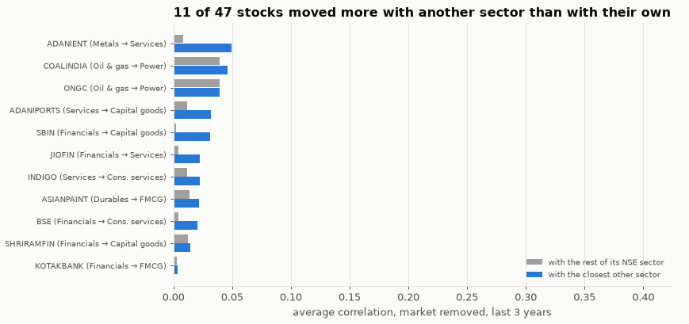
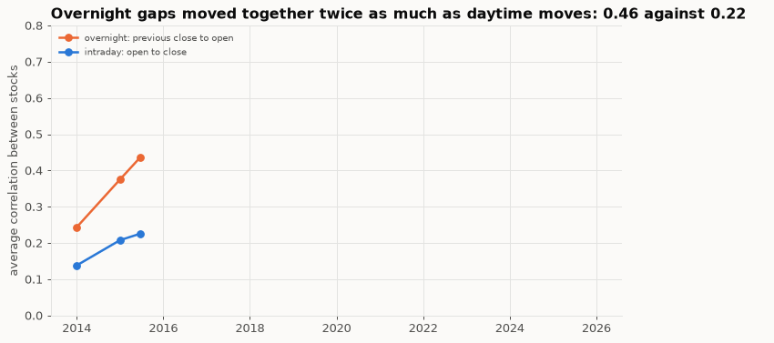
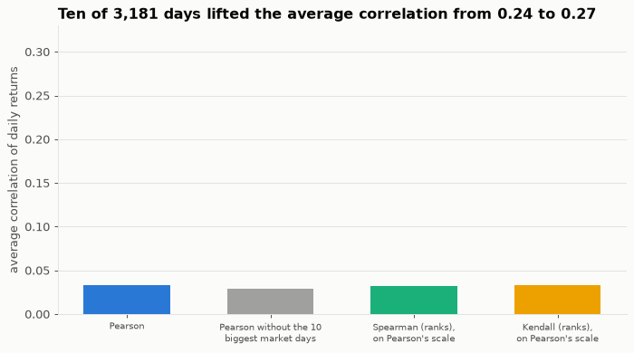
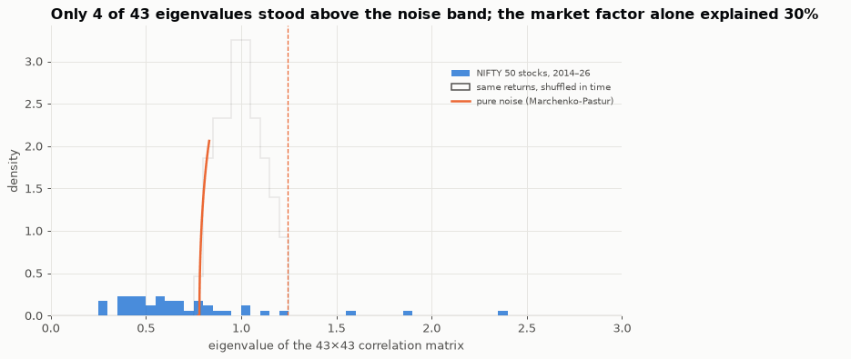

# Correlation Heatmap

[](https://github.com/Dhirajdas18/correlation-heatmap/actions/workflows/ci.yml)
[](https://dhirajdas18.github.io/correlation-heatmap/)

Which NIFTY 50 stocks move together, how much, and how that changes: clustering, measurement choices, noise
against signal, correlation through time, market networks, diversification, and links to the US market,
gold and the rupee, measured on NSE data.

**Live heatmap: [dhirajdas18.github.io/correlation-heatmap](https://dhirajdas18.github.io/correlation-heatmap/)**.
Pick a window, daily or weekly returns, Pearson or rank correlation, keep or remove the market, order by
cluster or by NSE sector, and click any square to see that
pair's correlation through time. It runs in your browser on five years of daily returns, rebuilt weekly.

## Features

- [x] Heatmap ordered by hierarchical clustering, with and without the market; clusters against NSE sectors
- [x] Measurement: Pearson against rank correlation; daily to quarterly returns; overnight against intraday; rank and weekly options in the heatmap
- [x] Noise against signal: random matrix theory, the market factor's share over time, cleaning the matrix; factor count in the heatmap
- [ ] Correlation through time: rolling, EWMA, DCC; falling together against rising together
- [ ] Networks: minimum spanning tree, hubs, 2020
- [ ] Diversification: effective number of bets; hierarchical risk parity walk-forward
- [ ] Across assets and time zones: US market, gold, the rupee; lead and lag

## Findings

### 1. Stocks moved with the market first: average correlation 0.26, and clustering raw correlations found one 29-stock block; with the market removed, 12 clusters matched NSE sectors twice as well

<a href="docs/img/heat_matrix.png"><picture><source media="(prefers-reduced-motion: reduce)" srcset="docs/img/heat_matrix.png"></picture></a>

Daily returns of today's NIFTY 50 stocks, 23 November 2023 to 23 November 2026 (740 days on which all 50
traded). Distance between two stocks is √(2(1 − correlation)); average-linkage clustering joins the closest
groups step by step, and its leaf order puts similar stocks side by side. "Market removed" takes out each
stock's beta × NIFTY's daily return (beta from the same days) before correlating what is left.

- **The market dominates:** the average pair correlated 0.26 (0.41 within the same NSE sector). The tightest
  pairs were ADANIENT–ADANIPORTS 0.81, BAJFINANCE–BAJAJFINSV 0.77, INFY–TCS 0.74 and JSWSTEEL–TATASTEEL 0.74;
  the loosest HINDUNILVR–ONGC 0.03.
- **Raw correlations cluster by how much a stock follows the market:** cut into 12 clusters, one held 29 of
  the 50 stocks, and the grouping matched NSE's sector labels with an adjusted Rand index of 0.16 (1 = the
  same grouping, 0 = unrelated).
- **With the market removed, sectors appear (adjusted Rand 0.35):** IT (TCS, INFY, HCLTECH, TECHM); private
  banks (HDFCBANK, ICICIBANK, AXISBANK, KOTAKBANK); Bajaj Finance, Bajaj Finserv and Shriram Finance;
  the two insurers; autos; cement; consumer staples with Asian Paints and Titan; pharma with the two
  hospital chains; and two mixed groups: state-owned companies (SBIN, NTPC, POWERGRID, ONGC, COALINDIA, BEL)
  with metals, the two Adani stocks and LT, and recent or high-growth listings (BSE, ETERNAL, INDIGO,
  JIOFIN, TRENT, TMPV).
- **Fairly stable:** clustering each half of the window separately gave groupings that agreed at 0.58.

<table><tr>
<td><a href="docs/img/heat_tree.png"><picture><source media="(prefers-reduced-motion: reduce)" srcset="docs/img/heat_tree.png"></picture></a></td>
<td><a href="docs/img/heat_misfits.png"><picture><source media="(prefers-reduced-motion: reduce)" srcset="docs/img/heat_misfits.png"></picture></a></td>
</tr></table>

- **Misfits (right):** with the market removed, 11 of the 47 stocks in sectors with more than one member
  moved more with another sector. SBIN correlated 0.25 with the capital-goods stock BEL and 0.02 on
  average with the other financials; ADANIENT 0.40 with ADANIPORTS (Services) against 0.07 with metals.
  NSE's 12-stock "Financial Services" spread over four clusters (private banks, Bajaj and Shriram,
  insurers, and BSE and JIOFIN with the recent listings); five of its stocks averaged 0.02 to 0.10 with the
  rest of it. ONGC and KOTAKBANK are near-ties (within 0.01).

### 2. Ten of 3,181 days lifted the average correlation from 0.241 to 0.275, and overnight gaps correlated twice as much as daytime moves (0.46 against 0.22)

<a href="docs/img/meas_overnight.png"><picture><source media="(prefers-reduced-motion: reduce)" srcset="docs/img/meas_overnight.png"></picture></a>

The 43 of today's NIFTY 50 stocks with prices on every day from January 2014 to November 2026 (3,181 days).
Overnight is the previous close to the open, intraday the open to the close; the two multiply back to the
day's return. Yahoo's opening prices are wrong on some demerger days (ADANIENT showed a +220% gap on
3 June 2015), so 88 stock-days whose overnight and intraday moves were both over 10% in opposite directions
were dropped.

- **Overnight moves were shared, daytime moves less so:** the average pair correlated 0.46 overnight and
  0.22 intraday, and overnight was higher in every year from 2014 to 2026 (0.71 against 0.33 in 2020).
  Overnight gaps carried 21% of the average stock's daily variance.

<table><tr>
<td><a href="docs/img/meas_methods.png"><picture><source media="(prefers-reduced-motion: reduce)" srcset="docs/img/meas_methods.png"></picture></a></td>
<td><a href="docs/img/meas_horizon.png"><picture><source media="(prefers-reduced-motion: reduce)" srcset="docs/img/meas_horizon.png"></picture></a></td>
</tr></table>

- **A few days carry a lot of the correlation (left):** leaving out the 10 days with the biggest average move
  (seven of them in March–May 2020, plus 24 August 2015, 20 September 2019 and 4 June 2024) lowered the
  average Pearson correlation from 0.275 to 0.241. Rank correlations count each day by its order only:
  Spearman 0.256 and Kendall 0.176, which on Pearson's scale (2·sin(π·ρs/6) and sin(π·τ/2), exact for
  normal data) are 0.267 and 0.272.
- **Horizon (right):** daily 0.275, weekly 0.279, monthly 0.295, quarterly 0.337. The 90% ranges, from
  resampling whole months, overlap (daily 0.238–0.312, quarterly 0.242–0.420), so 13 years can't separate
  them.

### 3. Only 4 of 43 eigenvalues stood above the noise band; the market factor's share peaked after the 2020 crash, not before it, and cleaning the matrix changed nothing out of sample

<a href="docs/img/rmt_spectrum.png"><picture><source media="(prefers-reduced-motion: reduce)" srcset="docs/img/rmt_spectrum.png"></picture></a>

A 43×43 correlation matrix (the stocks with prices every day from January 2014 to November 2026, 3,181 days)
has 43 eigenvalues that add up to 43; each measures how much movement one independent pattern explains.
Random matrix theory gives the range they would fill if the stocks were unrelated: the Marchenko-Pastur
band, (1 ± √(N/T))², here 0.78 to 1.25. Eigenvalues above it are real common movement.

- **Four real factors:** 12.95 (the market, 30% of all movement), 2.37, 1.90 and 1.58; together the other
  three explained 14%. The fifth, 1.24, sat just inside the band. Shuffling each stock's days in time (same
  returns, no co-movement) gave eigenvalues from 0.80 to 1.23, matching the band. 29 of the 43 fell below
  the band's lower edge; since the eigenvalues add up to 43 and the four factors take 18.8, the other 39
  average 0.62.

<table><tr>
<td><a href="docs/img/rmt_factors.png"><picture><source media="(prefers-reduced-motion: reduce)" srcset="docs/img/rmt_factors.png"></picture></a></td>
<td><a href="docs/img/rmt_share.png"><picture><source media="(prefers-reduced-motion: reduce)" srcset="docs/img/rmt_share.png"></picture></a></td>
</tr></table>

- **What the other three are (left):** factor 2 set IT (INFY, TCS, HCLTECH, TECHM) against banks and
  state-owned firms; factor 3 commodities and state-owned firms (ONGC, COALINDIA, NTPC, Tata Steel, Hindalco)
  against consumer names and lenders; factor 4 pharma with HUL and Nestlé against IT and ICICI Bank.
- **The market factor's share over time (right):** measured on each past year, monthly from 2009, it
  averaged 29%, fell to 18% in January 2018 and peaked at 46% in May 2020, after the March 2020 crash.
  Across 202 months its level did not predict the next month's NIFTY return (rank correlation 0.06,
  p = 0.39), nor did its 3-month change (0.02, p = 0.78). It went with higher volatility the next month
  (0.25), but this month's volatility did that better (0.61).
- **Cleaning didn't help:** every 6 months from 2014, a minimum-variance portfolio (shorting allowed) was
  built from the past 2 years' covariance, raw or with the noise eigenvalues replaced by their average
  ("clipping"), and held for 6 months. Over 25 periods both predicted 0.69% daily volatility and delivered
  0.79%; clipping changed realised volatility by 0.001 points.

## Quick start

```bash
uv sync
uv run python scripts/fetch_data.py         # Yahoo Finance -> data/prices.parquet, data/global.parquet
uv run ch report heatmap                    # also: measure, rmt; charts -> out/
uv run python scripts/build_site.py         # dashboard -> site/index.html
uv run pytest
```

## Design

- `src/ch/cluster.py`: correlation over common days, distance √(2(1 − ρ)), average-linkage clustering with
  optimal leaf order, adjusted Rand index, sector fit, and market removal.
- `src/ch/measure.py`: rank correlations and their conversion to Pearson's scale, returns over longer
  periods, overnight and intraday returns, and a month-block bootstrap of the average correlation.
- `src/ch/rmt.py`: eigenvalues, the Marchenko-Pastur band and density, shuffling, eigenvalue clipping and
  the market factor's share.
- `src/ch/heat.js`, `heatmap.html`: the same correlation (values or ranks, daily or weekly), market
  removal, clustering and eigenvalues (Jacobi) in the browser; a
  test runs them through Node against Python. Five years of returns are embedded as integers (0.001% units).
- `src/ch/data.py`: Yahoo prices for today's NIFTY 50, the index and two ETFs since 2007, with known errors
  repaired from `docs/data/yahoo_fixes.csv`; the S&P 500 total-return index and USD/INR in a separate
  table. Every series was scanned for one-day spike-and-reverse prints against the index; the remaining
  ones sit inside each day's traded range.
- `src/ch/reports.py`: README findings, reproducible with `ch report <topic>`.
- `src/ch/site.py`, `page.html`: the dashboard, one static page; no server.

MIT licence.
